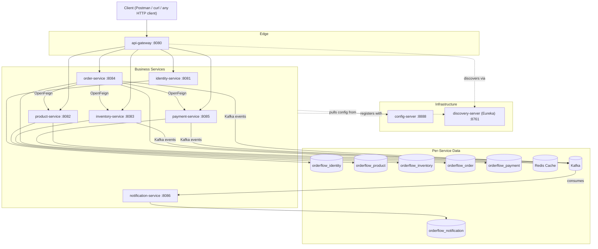

# OrderFlow — Enterprise Order Management Platform

OrderFlow is a microservices-based backend for a complete order-management lifecycle: user registration/login, product catalog & search, inventory management, order placement, payments, cancellation, order tracking, and notifications.

This is a **backend-only** platform — there is no frontend, and none is planned. It's built to resemble a real internal enterprise codebase, not a tutorial project.

## Table of Contents

- [Status](#status)
- [Architecture](#architecture)
- [Tech Stack](#tech-stack)
- [Module Map](#module-map)
- [Prerequisites](#prerequisites)
- [Getting Started](#getting-started)
- [Running the Platform](#running-the-platform)
- [Verifying a Service Is Up](#verifying-a-service-is-up)
- [Project Structure](#project-structure)
- [Engineering Standards](#engineering-standards)
- [Why This Foundation Looks the Way It Does](#why-this-foundation-looks-the-way-it-does)
- [Build Order / Roadmap](#build-order--roadmap)
- [Troubleshooting](#troubleshooting)

## Status

**Milestone 1 complete: Maven multi-module project structure.**

Every service module exists with its dependency-managed `pom.xml`, a bootstrap `@SpringBootApplication` class, a minimal `application.yml`, and the full production package skeleton. **No business logic, database wiring, Kafka wiring, or Docker setup exists yet** — those are added module-by-module, in the order in [Build Order / Roadmap](#build-order--roadmap), each going through Design → Implementation → Review → Testing before the next one starts.

What that means practically today: every service **builds** and **boots** (Spring context starts, Actuator health endpoint responds), but none of them expose real business APIs yet, and none of them require Postgres/Kafka/Redis to be running.

## Architecture



No service ever talks to another service's database directly. Synchronous calls go through OpenFeign (service-to-service REST); asynchronous, decoupled communication goes through Kafka.

## Tech Stack

| Category | Technology |
|---|---|
| Language | Java 21 |
| Framework | Spring Boot 3.3.5, Spring Security, Spring Data JPA, Spring Validation |
| Service mesh (Spring Cloud) | Config Server, Eureka Discovery, API Gateway, OpenFeign |
| Messaging | Apache Kafka |
| Database | PostgreSQL (one schema per service) |
| Cache | Redis |
| Build | Maven (multi-module) |
| Infra | Docker, Docker Compose *(added in a later phase)* |
| Libraries | Flyway, Lombok, MapStruct, JJWT, Resilience4j, Micrometer, Spring Boot Actuator, springdoc-openapi |

## Module Map

| Module | Role | Port | Owns DB |
|---|---|---|---|
| `config-server` | Centralized Spring Cloud Config | 8888 | — |
| `discovery-server` | Eureka service registry | 8761 | — |
| `api-gateway` | Reactive edge gateway (Spring Cloud Gateway) | 8080 | — |
| `identity-service` | Registration/login, JWT issuance, RBAC | 8081 | `orderflow_identity` |
| `product-service` | Product catalog & search | 8082 | `orderflow_product` |
| `inventory-service` | Stock levels & reservation | 8083 | `orderflow_inventory` |
| `order-service` | Order lifecycle, saga orchestration | 8084 | `orderflow_order` |
| `payment-service` | Payment processing | 8085 | `orderflow_payment` |
| `notification-service` | Event-driven notification dispatch | 8086 | `orderflow_notification` |

## Prerequisites

| Tool | Version | Required for |
|---|---|---|
| JDK | 21+ (this repo was built/verified against JDK 23, targeting `--release 21`) | Everything |
| Maven | 3.8+ (verified against 3.9.15) | Building/running |
| Docker & Docker Compose | Latest | Postgres/Redis/Kafka — *not needed yet, added in a later phase* |
| Git | Any recent version | Cloning, version control |

Check your local versions:

```bash
java -version
mvn -v
```

## Getting Started

Clone the repo and build the whole reactor from the root:

```bash
git clone <repo-url> orderflow
cd orderflow

# Fast structural/dependency check — no compilation
mvn -q validate

# Full build: compiles and installs every module into your local .m2
mvn clean install
```

If this is your first build, Maven will download the Spring Boot / Spring Cloud BOMs and all transitive dependencies — expect it to take a few minutes the first time and be near-instant afterward (cached in `~/.m2`).

## Running the Platform

### Right now (structure-only milestone)

Every module has a working bootstrap class and Actuator, so you can start any single service on its own — none of them require Postgres, Kafka, or Redis to be running yet, and none of them are wired to each other yet.

```bash
# From the repo root, run one service (module name = directory name):
mvn -pl config-server -am spring-boot:run
```

`-am` ("also make") builds any modules that one depends on first — with this repo's flat dependency graph that mainly matters the first time you run a module before `mvn install` has populated your local repo.

Run each service in its own terminal the same way, swapping the module name:

```bash
mvn -pl discovery-server -am spring-boot:run
mvn -pl api-gateway -am spring-boot:run
mvn -pl identity-service -am spring-boot:run
mvn -pl product-service -am spring-boot:run
mvn -pl inventory-service -am spring-boot:run
mvn -pl order-service -am spring-boot:run
mvn -pl payment-service -am spring-boot:run
mvn -pl notification-service -am spring-boot:run
```

### Once the platform is fully built (target end state)

The intended startup order — and the order `docker-compose.yml` will encode once it exists — is:

1. **Infrastructure containers**: PostgreSQL (one instance/schema per service, or one container per service), Redis, Kafka + Zookeeper/KRaft.
2. **`config-server`** — every other service pulls its config from here on boot.
3. **`discovery-server`** — every other service registers here.
4. **`api-gateway`** — the single entry point for all external traffic.
5. **Business services** in any order: `identity-service`, `product-service`, `inventory-service`, `order-service`, `payment-service`, `notification-service`.

At that point, all traffic goes through the gateway on `:8080`, and individual service ports are only for direct debugging.

## Verifying a Service Is Up

Every service exposes Spring Boot Actuator. Once a service is running, check its health endpoint:

```bash
curl http://localhost:8081/actuator/health   # identity-service, for example
```

Expected response once the app has started:

```json
{"status":"UP"}
```

Port reference is in the [Module Map](#module-map) above. `discovery-server` also has a browsable dashboard at [http://localhost:8761](http://localhost:8761) once it's running.

Once controllers exist, each business service will additionally expose interactive API docs via springdoc at `/swagger-ui.html`.

## Project Structure

```
orderflow/
├── pom.xml                  parent (dependency & plugin management)
├── config-server/
├── discovery-server/
├── api-gateway/
├── identity-service/
├── product-service/
├── inventory-service/
├── order-service/
├── payment-service/
├── notification-service/
├── docs/                    architecture docs, diagrams, ADRs (added as each module is built)
├── scripts/                 dev/ops scripts (added as needed)
└── infrastructure/          infra-as-code / local infra config (added in the Docker phase)
```

Each **business service** (`identity`, `product`, `inventory`, `order`, `payment`, `notification`) follows the same domain-driven package layout:

```
com.orderflow.<service>
├── config          application/security/cache configuration
├── controller      REST controllers
├── service
│   ├── impl        service implementations
│   └── interfaces  service contracts
├── repository      Spring Data JPA repositories
├── entity          JPA entities
├── dto             request/response DTOs (records where possible)
├── mapper          MapStruct mappers
├── event           domain/integration event payloads
├── kafka           producers & consumers
├── outbox          transactional outbox pattern
├── saga            saga participants/orchestration
├── cache           Redis cache abstractions
├── security        JWT filters, method security
├── audit           audit logging
├── validation      custom validators
├── exception       exceptions + global handler
├── util            stateless helpers
└── common          shared constants/enums local to the service
```

`config-server`, `discovery-server`, and `api-gateway` are infrastructure services, not domain services — they only get a `config` package.

## Engineering Standards

- Clean Architecture, SOLID, DRY, KISS
- Domain-driven package organization (above)
- Repository, DTO, and Service-Layer patterns; constructor injection everywhere
- Java records for DTOs where appropriate
- Global exception handling + a generic API response envelope
- Structured logging, audit logging, correlation IDs across service boundaries
- Optimistic locking, idempotency, retry, dead-letter queues, circuit breakers (Resilience4j)
- Redis caching where it earns its keep
- Outbox pattern and Saga pattern for cross-service consistency
- Never shared databases — every service owns its schema exclusively

## Why This Foundation Looks the Way It Does

**Parent POM imports BOMs instead of extending `spring-boot-starter-parent`.**
`orderflow-parent` is `groupId: com.orderflow`, packaging `pom`, and pulls in `spring-boot-dependencies` and `spring-cloud-dependencies` via `<dependencyManagement><scope>import</scope>`. This keeps the multi-module tree's own identity at the root while still getting Spring's curated, mutually-compatible dependency versions — the pattern real internal enterprise repos use, as opposed to tutorial repos that just extend the Spring Boot parent directly.

**Versions**: Java 21, Spring Boot 3.3.5, Spring Cloud 2023.0.3 (verified compatible release train), MapStruct 1.6.3, Lombok 1.18.34, JJWT 0.12.6, Resilience4j 2.2.0, springdoc-openapi 2.6.0.

**Annotation processing is centralized.** `maven-compiler-plugin` is configured once, in the parent's `pluginManagement`, with the Lombok → `lombok-mapstruct-binding` → MapStruct processor order required for MapStruct to see Lombok-generated accessors. Because Maven applies `pluginManagement` settings to default-lifecycle-bound plugins automatically, no child module has to repeat this configuration.

**`spring-boot-maven-plugin`** is version-managed centrally but only *declared* (with a `repackage` execution) in the 9 real services — the parent POM is `pom`-packaged and produces no runnable artifact.

**What's intentionally not wired up yet**: `application.yml` in every service currently has only `spring.application.name` and `server.port`. No service registers with Eureka via explicit config, imports from Config Server, or connects to Kafka/Redis yet — several services already carry the corresponding starter dependencies (e.g., `spring-cloud-starter-netflix-eureka-client`, `spring-kafka`) because they're part of the intended tech stack, but the actual wiring (service-url, config import, topic names, connection properties) is deferred to the phase where that piece of infrastructure is implemented and can be verified end-to-end, per the module-by-module build order. Wiring against infrastructure that doesn't exist yet would create configuration nobody could validate.

**Inter-service call ownership**: `order-service` orchestrates the order saga and therefore carries `spring-cloud-starter-openfeign` to call `product-service`, `inventory-service`, and `payment-service`. `inventory-service` and `payment-service` also carry OpenFeign for their own validation calls. `product-service` and `notification-service` are call *targets* / event consumers and don't need outbound Feign clients.

## Build Order / Roadmap

1. ~~Maven multi-module project structure~~ ✅
2. ~~Parent `pom.xml` dependency/plugin management~~ ✅
3. Shared conventions & standards (generic API response envelope, global exception handling, correlation ID propagation)
4. Config Server (externalized config for all services)
5. Discovery Server (Eureka)
6. API Gateway (routing, resilience, correlation IDs at the edge)
7. Identity Service (JWT auth & RBAC)
8. Product Service
9. Inventory Service
10. Order Service
11. Payment Service
12. Notification Service
13. Kafka messaging integration
14. Redis caching
15. Saga pattern
16. Outbox pattern
17. Dockerization (`Dockerfile` per service + root `docker-compose.yml`)
18. Comprehensive testing & documentation

Each numbered item goes through Design → Implementation → Review → Testing before the next one starts. `docker-compose.yml` is intentionally not present yet — it's defined last, against real working services, instead of as a placeholder.

## Troubleshooting

**`mvn` fails with "release version 21 not supported"**
Your `JAVA_HOME` points at a pre-21 JDK. Install/select a JDK 21+ and make sure `java -version` reflects it before building.

**A service fails to start with a port-in-use error**
Something else on your machine is already bound to that port. Check the [Module Map](#module-map) for the expected port, free it, or (once config wiring exists) override `server.port` via an environment variable or Config Server.

**`mvn -pl <service> spring-boot:run` fails because the parent isn't installed**
Run `mvn install -N` at the repo root first (installs just the parent POM), or use `-am` as shown in [Running the Platform](#running-the-platform) so Maven builds prerequisite modules automatically.

**Lombok-generated methods "don't exist" in your IDE**
Make sure your IDE has annotation processing enabled and the Lombok plugin installed (IntelliJ: `Settings → Plugins → Lombok`, and `Settings → Build → Compiler → Annotation Processors → Enable annotation processing`).
