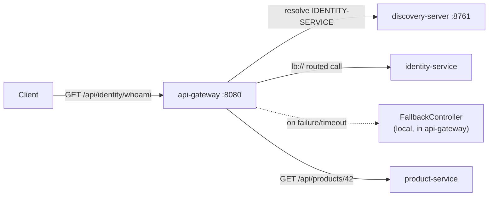

# API Gateway

## Architecture

`api-gateway` is a Spring Cloud Gateway instance — reactive/WebFlux, not the older MVC-based Zuul-style gateway — sitting in front of the 6 business services. It resolves `lb://{SERVICE-NAME}` URIs through Eureka (via `discovery-server`) and client-side load balancing, so it never needs a hardcoded downstream host:port, and picking up a second instance of any service later requires no gateway change at all.

Routes, resilience config, and everything else the gateway needs are centralized in `config-repo/api-gateway.yml`, following the same pattern established by every other service — see [`docs/config-server.md`](config-server.md).



## Routing

| External path | Filter chain | Routed to |
|---|---|---|
| `/api/identity/**` | `StripPrefix=2` → `CircuitBreaker(identityServiceCB)` | `lb://IDENTITY-SERVICE` |
| `/api/products/**` | `StripPrefix=2` → `CircuitBreaker(productServiceCB)` | `lb://PRODUCT-SERVICE` |
| `/api/inventory/**` | `StripPrefix=2` → `CircuitBreaker(inventoryServiceCB)` | `lb://INVENTORY-SERVICE` |
| `/api/orders/**` | `StripPrefix=2` → `CircuitBreaker(orderServiceCB)` | `lb://ORDER-SERVICE` |
| `/api/payments/**` | `StripPrefix=2` → `CircuitBreaker(paymentServiceCB)` | `lb://PAYMENT-SERVICE` |
| `/api/notifications/**` | `StripPrefix=2` → `CircuitBreaker(notificationServiceCB)` | `lb://NOTIFICATION-SERVICE` |

`StripPrefix=2` removes the first two path segments (`/api/{service}`) before forwarding, so `/api/identity/whoami` reaches `identity-service` as `GET /whoami`. All 6 routes are shaped identically today; a service that later needs different behavior (a different path prefix, an extra filter) gets its own route entry — nothing here assumes uniformity going forward, it's just what's true right now.

## Resilience

Each route's `CircuitBreaker` filter is backed by Resilience4j, configured in `config-repo/api-gateway.yml`:

- `slidingWindowSize: 10`, `minimumNumberOfCalls: 5`, `failureRateThreshold: 50` — the circuit opens once at least 5 calls have been recorded in the last 10 and 50%+ failed.
- `waitDurationInOpenState: 10s`, `permittedNumberOfCallsInHalfOpenState: 3` — after 10s open, 3 trial calls decide whether to close again or reopen.
- `slowCallDurationThreshold: 3s`, `slowCallRateThreshold: 50` — a call slower than 3s counts as a "slow call" for the failure-rate calculation, not just outright errors.
- A `TimeLimiter` (`timeoutDuration: 4s`) bounds how long the gateway waits on a downstream call before treating it as failed, independent of the circuit's own state.

Critically, the fallback doesn't only trigger when the circuit is *open* — any individual call that throws (connection refused, timeout) is caught and forwarded to `FallbackController` regardless of the circuit's current state. The circuit breaker's job is deciding when to stop *trying* calls at all (fail fast without even attempting the network call); the fallback's job is turning any failure, tried or skipped, into a clean response instead of a raw error propagating to the client. `CircuitBreakerFallbackIntegrationTest` proves this on a single deliberately-unreachable call, without needing to drive the circuit into the open state first.

## Correlation IDs at the Edge

`CorrelationIdGlobalFilter` runs at `Ordered.HIGHEST_PRECEDENCE` — before routing — so every request, whether it reaches a real service or dead-ends in a fallback, carries the same `X-Correlation-Id`:

1. Read `X-Correlation-Id` from the incoming request; generate a UUID if absent.
2. Mutate the request (adding/overwriting that header) so whichever service the request is routed to receives it.
3. Set the same value on the response headers immediately, so it's present even if the eventual response comes from `FallbackController` rather than a proxied call.

This is the reactive-stack counterpart to `common-library`'s servlet-based `CorrelationIdFilter` — not the same class, because `api-gateway` is WebFlux and can't take a servlet-stack dependency. See the Interview Notes below for why MDC-based correlated *logging* (as opposed to header propagation) is only partially replicated here.

## API

Not applicable in the usual sense — `api-gateway` exposes no REST surface of its own beyond what it proxies, plus:

| Path | Purpose |
|---|---|
| `GET /actuator/health` | Gateway's own health |
| `GET /actuator/gateway/routes` | Introspect the currently loaded route definitions |
| `GET|POST|PUT|DELETE /fallback/{service}` | Internal — never called directly by a client; only ever reached via a route's `fallbackUri` |

### Sample curl requests

```bash
# Route to identity-service (falls back today - identity-service has no real endpoints yet)
curl -i http://localhost:8080/api/identity/whoami

# Same call, explicit correlation id - echoed back unchanged on the response
curl -i -H "X-Correlation-Id: demo-trace-1" http://localhost:8080/api/identity/whoami

# Introspect loaded routes
curl http://localhost:8080/actuator/gateway/routes
```

## Database Schema / Event Flow

Not applicable — `api-gateway` owns no database and publishes/consumes no Kafka events; it's a pure request router.

## Security

Deliberately **not** Basic Auth-protected the way `config-server`/`discovery-server` are — this is the public edge, and real end-user authentication is JWT-based, arriving with Identity Service (roadmap item 7). Locking the gateway down with a shared Basic Auth credential today would be security theater: it protects nothing a real client needs to get past, and would need to be ripped out the moment JWT validation lands. `/actuator/gateway/routes` currently discloses route topology to anyone who can reach the gateway — acceptable for this stage, worth revisiting (e.g. restricting actuator exposure, or requiring auth on management endpoints specifically) once the platform has a real perimeter.

## Interview Notes

- **Why `spring-cloud-starter-circuitbreaker-reactor-resilience4j` in addition to `resilience4j-spring-boot3`?** They serve different needs. `resilience4j-spring-boot3` gives property-driven registries, actuator health indicators, and `/actuator/circuitbreakers` — useful, but it doesn't produce a `ReactiveCircuitBreakerFactory`, which is the one thing Spring Cloud Gateway's `CircuitBreaker` `GatewayFilterFactory` actually needs to exist as a bean. The Spring Cloud starter supplies exactly that, reading the same `resilience4j.circuitbreaker.*`/`resilience4j.timelimiter.*` properties, so the two configs aren't duplicated - just interpreted by two consumers with different jobs.
- **Why does the fallback controller define its own response shape instead of reusing `common-library`'s `ApiResponse`?** `common-library` isn't a dependency of `api-gateway` at all (see [`docs/common-library` section in README](../README.md#common-library)) — it pulls in servlet-stack assumptions (`HttpServletRequest`-based filters) that would fight with Gateway's Netty/WebFlux runtime. `GatewayErrorResponse` is intentionally smaller than `ApiResponse` too: it only ever represents one case ("downstream unavailable"), so it doesn't need `ApiResponse`'s generic `data`/`errors` fields.
- **Why is MDC-based correlated logging only partially done here?** `common-library`'s `CorrelationIdFilter` puts the id in MDC for the *entire* request lifetime because servlet request handling stays on one thread. WebFlux doesn't offer that guarantee — a single request's processing can hop across multiple event-loop threads as it moves through the reactive chain, and MDC is thread-local, so a naive `MDC.put` at the top of a `GlobalFilter` would leak across unrelated requests sharing threads, or simply not be visible by the time a later stage logs something. The correct fix is a Reactor `Context` ↔ MDC bridge (e.g. via `Hooks.onEachOperator`, wiring the correlation id from the reactive context into MDC just before each log call). That's more logging infrastructure than this milestone needs — the filter here still puts the id in MDC around its own single, synchronous log statement (safe, since that happens before any thread handoff) and guarantees it and reaches every downstream service via the header regardless.
- **Why `StripPrefix=2` and an `/api/{service}` external shape, instead of exposing each service's paths unprefixed at the root?** A single flat namespace would immediately collide the moment two services want the same path shape (e.g. both wanting `/health` or `/search`), and gives the gateway nowhere to hang cross-cutting concerns (rate limiting per service, auth scoping per prefix) later. Prefixing by service name costs one path segment and buys collision-freedom and a natural place to attach future per-service policy.
