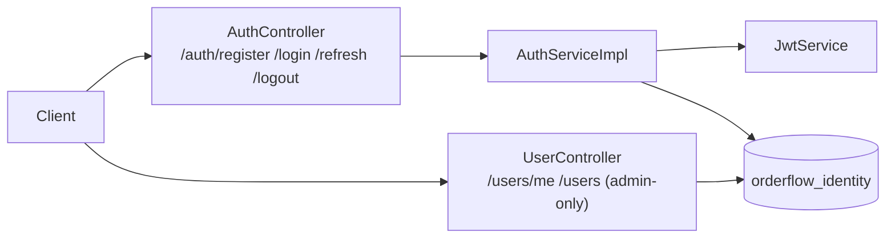
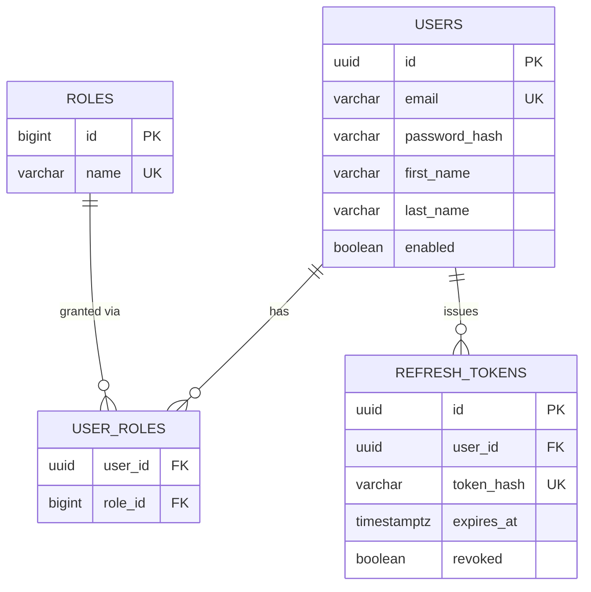

# Identity Service

## Architecture

`identity-service` (port `8081`) is the first business service with real functionality: registration, login, JWT issuance, token refresh/rotation, logout, and RBAC (`CUSTOMER`/`ADMIN`). It's the first service in the platform with an actual database (`orderflow_identity`, Postgres) and the first to exercise Spring Security end to end.



### Auth model

- **Access token**: a signed JWT (HS256), short-lived (`900000ms` / 15 min by default), carrying `sub` (email), `userId`, `roles` (already `ROLE_`-prefixed), `iss`, `iat`, `exp`. Validated statelessly by `JwtAuthenticationFilter` on every request - no database lookup per request, since everything needed is in the token's own claims.
- **Refresh token**: an opaque random UUID string, returned to the client once and never stored in plaintext - only its SHA-256 hash lives in `refresh_tokens.token_hash`. Long-lived (`604800000ms` / 7 days by default). Every successful `/auth/refresh` call **rotates** the token: the old one is marked `revoked` and a new one issued, so a stolen-and-reused old refresh token is a detectable, blockable event rather than a silent forever-valid credential.
- **RBAC**: two seeded roles, `CUSTOMER` (default on registration) and `ADMIN`. Enforced with `@PreAuthorize("hasRole('ADMIN')")` at the controller-method level (see `UserController.getAllUsers`), not with more URL-pattern rules in `SecurityConfig` - keeps the security filter chain itself simple (just "does this request have *any* valid authentication"), and puts role checks where the specific business rule actually lives.

### Why stateless claims, not a UserDetailsService lookup, on every request

`JwtAuthenticationFilter` builds the `Authentication` directly from the token's own claims and never touches the database. `CustomUserDetailsService`/`UserPrincipal` still exist, but only for the login flow, where `AuthenticationManager`/`DaoAuthenticationProvider` needs a real `UserDetails` to check the submitted password against. The trade-off: a user disabled or re-roled mid-flight keeps acting under their old identity until their *access* token naturally expires (15 minutes by default) - accepted here as the standard cost of stateless JWT auth, in exchange for not paying a database round trip on every single authenticated request.

## Seeded Data

Flyway (`src/main/resources/db/migration/`) owns schema and static reference data:

| Migration | Creates |
|---|---|
| `V1__create_roles_table.sql` | `roles` |
| `V2__create_users_table.sql` | `users` |
| `V3__create_user_roles_table.sql` | `user_roles` (join table) |
| `V4__seed_roles.sql` | The two `roles` rows: `CUSTOMER`, `ADMIN` |
| `V5__create_refresh_tokens_table.sql` | `refresh_tokens` |

The first **admin account**, in contrast, is **not** seeded via Flyway - `AdminBootstrapRunner` (`config` package, an `ApplicationRunner`) creates it on every boot, idempotently (a no-op once an account with that email exists). This is deliberate: the password needs `PasswordEncoder.encode(...)` at whatever algorithm/strength is actually configured, which a SQL migration can't call - hand-computing a bcrypt hash to paste into a migration is exactly the kind of thing that quietly breaks the next time the encoder changes. Credentials: `ADMIN_EMAIL`/`ADMIN_PASSWORD` env vars, dev-only defaults `admin@orderflow.dev` / `ChangeMe123!` - same pattern, same warning, as every other credential in this repo.

## API

| Method | Path | Auth | Purpose |
|---|---|---|---|
| `POST` | `/auth/register` | none | Create an account (defaults to `CUSTOMER` role); returns tokens immediately |
| `POST` | `/auth/login` | none | Exchange email+password for tokens |
| `POST` | `/auth/refresh` | none (refresh token in body) | Rotate a refresh token for a new access+refresh pair |
| `POST` | `/auth/logout` | none (refresh token in body) | Revoke a refresh token |
| `GET` | `/users/me` | any authenticated user | Current user's profile |
| `GET` | `/users` | `ADMIN` only | List all users |

All responses use `common-library`'s `ApiResponse<T>` envelope. Reached externally through the gateway as `/api/identity/**` (see [API Gateway](api-gateway.md)) - the paths above are as seen *inside* identity-service, after the gateway's `StripPrefix=2`.

### Sample curl requests

```bash
# Register
curl -X POST http://localhost:8081/auth/register -H "Content-Type: application/json" \
  -d '{"email":"jane@orderflow.dev","password":"password123","firstName":"Jane","lastName":"Doe"}'

# Login
curl -X POST http://localhost:8081/auth/login -H "Content-Type: application/json" \
  -d '{"email":"jane@orderflow.dev","password":"password123"}'

# Protected endpoint (replace with a real access token from login)
curl http://localhost:8081/users/me -H "Authorization: Bearer <accessToken>"

# Admin-only endpoint - default seeded admin
curl -X POST http://localhost:8081/auth/login -H "Content-Type: application/json" \
  -d '{"email":"admin@orderflow.dev","password":"ChangeMe123!"}'
curl http://localhost:8081/users -H "Authorization: Bearer <adminAccessToken>"

# Refresh (rotates the token - the old refreshToken stops working after this call)
curl -X POST http://localhost:8081/auth/refresh -H "Content-Type: application/json" \
  -d '{"refreshToken":"<refreshToken>"}'

# Logout (revokes the token)
curl -X POST http://localhost:8081/auth/logout -H "Content-Type: application/json" \
  -d '{"refreshToken":"<refreshToken>"}'
```

## Database Schema



Not applicable: Kafka events (identity-service publishes none yet - deferred to the Kafka integration phase, item 13, if/when other services need to react to account creation).

## Security

- **Stateless**: `SessionCreationPolicy.STATELESS`, CSRF disabled (no cookie-based session to forge).
- **Password hashing**: BCrypt (`BCryptPasswordEncoder`).
- **Refresh tokens**: stored as SHA-256 hashes only, never plaintext; rotated on every use.
- **JWT signing secret** (`orderflow.jwt.secret`) lives in the *shared* `config-repo/application.yml` (not `identity-service.yml`) as a plaintext, env-var-overridable, dev-only-default value - every service that validates a token needs the identical key, not a copy (see `docs/product-service.md`). The seed admin's password (`orderflow.admin.*`) stays in `config-repo/identity-service.yml`, since seeding the one admin account is identity-service's job alone. Both follow the same pattern already used for Config Server's and Discovery Server's own credentials (see [Config Server → Security](config-server.md)). The JWT secret specifically carries higher stakes than those: it's a genuine token-signing key, not a Basic Auth password for an internal admin tool - anyone with it can forge valid access tokens. Still acceptable for local/dev; **encryption support (`{cipher}...`) backed by a real key/HSM, not plaintext YAML, is required before any real deployment** - noted here and in `docs/config-server.md` so it isn't forgotten.
- **Unauthenticated requests to a protected endpoint** get a `401` in the same `ApiResponse` envelope as everything else, via `JwtAuthenticationEntryPoint` - Spring Security's `ExceptionTranslationFilter` runs before `DispatcherServlet`, so `common-library`'s `GlobalExceptionHandler`/`SecurityExceptionAutoConfiguration` (both `@RestControllerAdvice`, only invoked during MVC dispatch) never see this failure. As of Phase 3, `JwtAuthenticationFilter`/`JwtAuthenticationEntryPoint`/`JwtService`/`JwtProperties` all live in `common-library` (`com.orderflow.common.security`), shared with any other service that validates the same tokens (starting with `product-service`) - see [`docs/phase-3.md`](phase-3.md) and [`docs/product-service.md`](product-service.md) for why. `UserPrincipal`/`CustomUserDetailsService` stay identity-service-local; they're only needed for the password-login flow.

## Interview Notes

- **Why rotate refresh tokens instead of reusing one until it expires?** Rotation turns "an attacker captured an old refresh token" into a detectable event: if the legitimate client's next refresh attempt fails because the token was already consumed (by the attacker, who got there first), that's a signal something is wrong, rather than the attacker silently riding the same token indefinitely. A production system would go further (family-based revocation: if a *revoked* token is presented again, revoke the entire chain) - not implemented here, but the schema (each `RefreshToken` row already tracks its own state) supports adding it later without a redesign.
- **Why hash refresh tokens but not compare them in constant time?** SHA-256 lookup-by-hash is a deliberate simplification: unlike a password (low-entropy, guessable, needs bcrypt's deliberately-slow work factor), a refresh token is a 128-bit random UUID - there's nothing to brute-force offline even with the hash exposed, so a fast cryptographic hash (indexed, fast lookups) is the right tool, not a slow password-hashing algorithm.
- **Why is `common-library`'s `GlobalExceptionHandler` not what catches a bad-login attempt?** `AuthServiceImpl.login` explicitly catches `AuthenticationException` from `AuthenticationManager.authenticate(...)` and rethrows `UnauthorizedException` - a normal `BusinessException` the existing handler already knows how to map. The *only* auth failure that bypasses ordinary MVC exception handling is a missing/invalid JWT on an already-protected endpoint, since that's rejected by the security filter chain before a controller is ever reached - that's what `JwtAuthenticationEntryPoint` is specifically for.
- **Why does `AdminBootstrapRunner` run on every boot instead of once?** It's idempotent (checked via `existsByEmail`), so "run once" and "run on every boot and check" are behaviorally identical but the latter needs no separate bookkeeping (a "have I done this before" flag) - the check *is* the bookkeeping.
