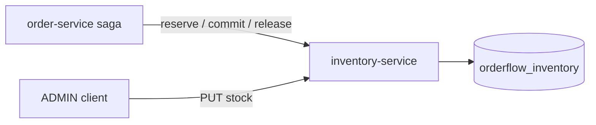

# Inventory Service

## Architecture

`inventory-service` (port `8083`, database `orderflow_inventory`) owns stock levels. It exposes two kinds of operation:

- **Admin**: set the quantity on hand for a product (`PUT /inventory/{productId}`, `ADMIN` only).
- **Reservation**: the three steps order-service calls during the saga: `reserve`, `commit`, `release`.



## Stock model

Each product has an `inventory_items` row with `quantity_on_hand` and `quantity_reserved`. Available stock is `on_hand - reserved`.

Each order's claim on a product is a `stock_reservations` row in state `RESERVED`, `COMMITTED`, or `RELEASED`.

| Operation | Effect |
|---|---|
| `reserve(orderId, lines)` | For each line: `reserved += qty` (fails with 409 if available < qty), insert a `RESERVED` row |
| `commit(orderId)` | For each `RESERVED` row: `on_hand -= qty`, `reserved -= qty`, row becomes `COMMITTED` |
| `release(orderId)` | For each `RESERVED` row: `reserved -= qty`, row becomes `RELEASED` |

Schema constraints back the arithmetic: `quantity_reserved <= quantity_on_hand`, both non-negative, and a unique `(order_id, product_id)` on reservations.

## Guarantees

- **All-or-nothing reserve.** Lines are processed in product-id order inside one transaction. If any line lacks stock, the whole transaction rolls back and no reservation survives.
- **Idempotent reserve.** If the order already has reservations, `reserve` is a no-op. A retried saga step cannot double-reserve.
- **Idempotent release.** Releasing an unknown or already-released order is a no-op, so compensation can always be retried safely.
- **Serialized stock mutations.** `findForUpdate` takes a `PESSIMISTIC_WRITE` row lock on the product, so two concurrent orders for the same product queue up instead of both passing the availability check.
- **Quantity on hand cannot drop below what is reserved.** Setting it lower returns 409.

## API

| Method | Path | Auth | Purpose |
|---|---|---|---|
| `GET` | `/inventory/{productId}` | authenticated | Stock level (on hand, reserved, available) |
| `PUT` | `/inventory/{productId}` | `ADMIN` | Set quantity on hand |
| `POST` | `/inventory/reservations` | authenticated | Reserve stock for an order (called by order-service) |
| `POST` | `/inventory/reservations/{orderId}/commit` | authenticated | Commit an order's reservations |
| `POST` | `/inventory/reservations/{orderId}/release` | authenticated | Release an order's reservations |

Reached externally through the gateway as `/api/inventory/**`.

### Sample curl requests

```bash
# Admin sets stock
curl -X PUT http://localhost:8083/inventory/<productId> -H "Authorization: Bearer <adminToken>" \
  -H "Content-Type: application/json" -d '{"quantityOnHand":10}'

# Anyone authenticated reads it
curl http://localhost:8083/inventory/<productId> -H "Authorization: Bearer <token>"
```

## Known gap: service-to-service calls

The reservation endpoints are called by order-service with the customer's own token. Any authenticated caller can therefore call them directly, including reserving or committing stock for an arbitrary order id. Service identity (a dedicated service account, or mTLS between services) is not implemented yet. This is recorded in `phase-4.md`.

## Tests

- `InventoryItemTest`: the stock arithmetic (reserve, commit, release, the on-hand floor). Pure unit tests.
- `InventoryServiceImplTest`: idempotency, insufficient stock creating no reservation, unknown-order handling. Mockito.
- `InventoryControllerIntegrationTest`: reserve-then-commit, release, over-reserve 409, customer 403 on admin endpoint, unauthenticated 401. Real Postgres via Testcontainers.

## Interview notes

- **Why pessimistic locks rather than `@Version` optimistic locking here?** Optimistic locking would let both concurrent reservations read the same availability and one would fail at commit time with an error the customer sees. A row lock serializes them and the second one gets an honest "insufficient stock" answer.
- **Why reserve-then-commit instead of decrementing on hand directly?** A reservation can be released if a later saga step fails. Decrementing on hand immediately would require a compensating increment with its own failure modes.
