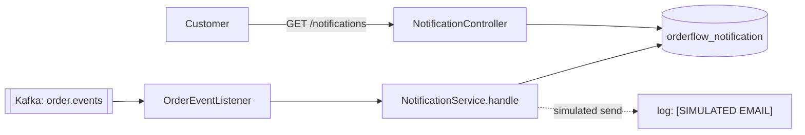

# Notification Service

## Architecture

`notification-service` (port `8086`, database `orderflow_notification`) consumes `order.events` from Kafka and records a notification for each order confirmation or cancellation. It exposes one read endpoint so a customer can see their own notifications.



## Delivery is simulated

The "send" is a single log line tagged `[SIMULATED EMAIL]`, and the notification row is stored with status `SENT`. A real email or SMS provider adapter would replace that one line.

## Idempotency

Kafka delivers at least once, so the same event can arrive twice (see the outbox section in `order-service.md`). `NotificationServiceImpl.handle` checks `existsByEventId` before doing anything, and the `notifications.event_id` column is unique. A redelivered event is skipped, so a customer never gets two emails for one order.

## Error handling

`KafkaErrorConfig` wires a `DefaultErrorHandler`:

- A listener failure is retried 3 times, one second apart.
- After that the record is published to `order.events.DLT` with its original headers, and consumption moves on.
- A payload that is not valid JSON is not retried at all. It goes straight to the dead-letter topic.

Unknown event types are logged and ignored rather than dead-lettered, since a newer producer may legitimately emit types this service doesn't render yet.

## Event contract

The consumer keeps its own copy of the event record (`messaging/OrderEvent`) rather than importing order-service's class. The JSON is the contract; services share a wire format, not a compile-time type.

## API

| Method | Path | Auth | Purpose |
|---|---|---|---|
| `GET` | `/notifications` | authenticated | The caller's own notifications, newest first, paginated |

The recipient is taken from the token, so a customer can only read their own notifications. Reached externally through the gateway as `/api/notifications/**`.

### Sample curl request

```bash
curl http://localhost:8086/notifications -H "Authorization: Bearer <token>"
```

## Tests

- `NotificationServiceImplTest`: confirmed and cancelled notifications, skipping a redelivered event, ignoring unknown types. Mockito.
- `NotificationIntegrationTest`: a real event published to Kafka becomes a notification visible through the API; the same event published twice produces one row. Real Postgres and Kafka via Testcontainers.

## Interview notes

- **Why store notifications instead of just sending them?** The stored row is the record of what was communicated, is the basis for the customer-facing history endpoint, and is what makes redelivery safe: deduplication needs durable state, not an in-memory set.
- **Why a dead-letter topic rather than dropping poison messages?** A dropped message is silently lost. A dead-lettered one can be inspected, fixed, and replayed.
