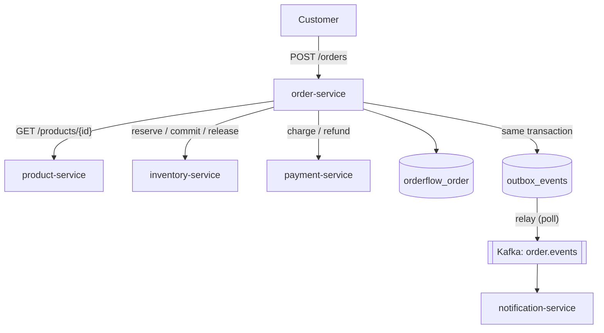

# Order Service

## Architecture

`order-service` (port `8084`, database `orderflow_order`) places and tracks customer orders. It is the orchestrator of the order saga: it is the only service that calls inventory and payment during order placement, and the only one that publishes order events to Kafka.



## The saga

Placing an order runs these steps in order:

1. **Price.** Fetch each product from product-service. Reject inactive products (409) and unknown products (404). Duplicate products in one order are rejected up front (400).
2. **Create PENDING order.** Persist the order and its items in one short transaction.
3. **Reserve stock.** Call inventory `reserve`. A 409 from inventory cancels the order ("Insufficient stock…").
4. **Charge payment.** Call payment `charge` for the total. A `DECLINED` status releases the reservation and cancels the order. A payment-service outage releases the reservation and cancels the order.
5. **Commit stock.** Call inventory `commit`. If this fails, refund the payment, release the reservation, and cancel the order.
6. **Confirm.** Mark the order CONFIRMED and write an `ORDER_CONFIRMED` outbox event in the same transaction.

Cancellation at any step writes an `ORDER_CANCELLED` outbox event carrying the reason. Each remote call is made outside any open database transaction.

```
PENDING --reserve--> --charge--> --commit--> CONFIRMED
   |                    |             |
   +--- cancel <--------+-------------+   (compensations run for completed steps)
```

Compensations: a reservation is released on any failure after it was made. A payment is refunded only if the commit failed after the charge succeeded.

## Transactional outbox

Events are not sent to Kafka inside the saga. Instead, `OutboxService.enqueue` writes an `outbox_events` row in the same transaction as the order change it describes. `OutboxPublisher` runs every `orderflow.outbox.poll-interval-ms` (default 1 s), locks up to 100 unpublished rows with `FOR UPDATE SKIP LOCKED`, sends each to Kafka keyed by order id, and marks it published.

Why this matters: if Kafka is down when an order is confirmed, the order is still committed and the event is still delivered later. The order and its announcement can never disagree. `enqueue` is declared `MANDATORY` so it cannot be called outside the order's transaction by accident.

Delivery is at least once: if the relay crashes between a successful send and the commit that marks the row published, the event is sent again. Consumers deduplicate by `eventId`.

## Kafka event

Topic `order.events`, 3 partitions, keyed by order id so one order's events stay ordered. Value is JSON:

```json
{
  "eventId": "uuid",
  "eventType": "ORDER_CONFIRMED | ORDER_CANCELLED",
  "orderId": "uuid",
  "customerEmail": "jane@orderflow.dev",
  "totalAmount": 50.00,
  "status": "CONFIRMED",
  "reason": null,
  "occurredAt": "2026-10-15T10:00:00Z"
}
```

The topic is declared by `KafkaTopicConfig`, since the producer owns its shape.

## API

| Method | Path | Auth | Purpose |
|---|---|---|---|
| `POST` | `/orders` | authenticated | Place an order (201 when confirmed; 409/503 with a reason otherwise) |
| `GET` | `/orders/{id}` | owner or `ADMIN` | One order. Another customer's order returns 404 so ids can't be probed |
| `GET` | `/orders` | authenticated | The caller's own orders, paginated |

Reached externally through the gateway as `/api/orders/**`.

### Sample curl requests

```bash
curl -X POST http://localhost:8084/orders -H "Authorization: Bearer <token>" \
  -H "Content-Type: application/json" -d '{"items":[{"productId":"<uuid>","quantity":2}]}'
curl http://localhost:8084/orders -H "Authorization: Bearer <token>"
```

## Token forwarding

`FeignConfig` copies the caller's `Authorization` header onto every saga call, so inventory and payment see the customer as the requester. Calls made outside a web request (the outbox relay) carry no header and need none.

## Failure modes and known limits

- **Crash mid-saga.** An order left PENDING because the process died between steps is not yet swept by a recovery job. It stays PENDING and any reservation it made stays RESERVED. A recovery job that finds stale PENDING orders and runs their compensations is the next thing to build.
- **Failed compensation.** If a release or refund itself fails, it is logged with the order id for manual reconciliation rather than retried by a background job.
- **Service identity.** Inventory and payment accept any authenticated caller, as noted in their own docs.

## Tests

- `OrderServiceImplTest`: pricing rules (duplicate product, inactive product, unknown product), delegation to the saga, ownership checks on reads. Mockito.
- `OrderControllerIntegrationTest`: confirmed flow end to end with the outbox event reaching `published=true`; insufficient stock cancels without charging; declined payment releases stock; failed commit refunds and releases; cross-customer read is 404; unauthenticated 401. Real Postgres and Kafka via Testcontainers, with the three Feign clients mocked at their boundary.

## Interview notes

- **Why orchestration rather than choreography?** The saga has one decision-maker and one place to read the flow. Choreography spreads the same logic across three services and their event handlers, which is harder to reason about when a compensation fails halfway.
- **Why an outbox instead of publishing after commit?** Publishing after commit has a window where the database says CONFIRMED and Kafka never heard about it. The outbox moves that window into the database, where the transaction already guarantees atomicity.
- **Why are remote calls outside the transaction?** Holding a database transaction open across network calls to other services ties up a connection for their latency and can hold row locks indefinitely if one of them hangs.
