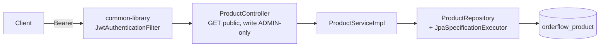

# Product Service

## Architecture

`product-service` (port `8082`) owns the product catalog: create/update/deactivate a product, look one up by id, and search/browse with pagination. It's the second business service with a real database (`orderflow_product`) and the first service *besides* `identity-service` to validate JWTs — which is the main architectural event of this phase, not the CRUD itself. See [Common Library's JWT Extraction](#why-jwt-validation-moved-into-common-library) below.



## Why JWT Validation Moved Into `common-library`

Before this phase, `identity-service` had its own private `JwtService`/`JwtAuthenticationFilter`/`JwtAuthenticationEntryPoint`/`JwtProperties` — fine when it was the only service with any notion of "who is calling me." `product-service` is the first service that also needs to know that, and the tokens it needs to validate are the exact same tokens `identity-service` issues (same HS256 secret, same claim shape). Two paths existed:

1. Duplicate the filter into `product-service` too (and every service after it).
2. Extract it once into `common-library`, the module that already exists specifically to avoid this kind of duplication (see `CorrelationIdFilter`, `GlobalExceptionHandler`).

Option 2 won, for the same reason `common-library` exists at all. What moved to `com.orderflow.common.security` (`JwtAuthenticationAutoConfiguration`, gated `@ConditionalOnClass({Jwts.class, AccessDeniedException.class})` — both `<optional>` in `common-library`'s own `pom.xml`, so this stays completely inert for the 4 business services that haven't opted in yet):

| Class | Role |
|---|---|
| `JwtProperties` | `orderflow.jwt.*` binding — now sourced from the **shared** `config-repo/application.yml`, not `identity-service.yml`, since the signing secret must be identical everywhere HS256 verification happens |
| `JwtService` | Both issues (`generateAccessToken`) and verifies (`parseClaims`) — only `identity-service` calls the former, every validating service calls the latter |
| `JwtAuthenticationFilter` | Stateless: builds an `Authentication` straight from a token's own claims, no database lookup, identical behavior in every service that uses it |
| `JwtAuthenticationEntryPoint` | Turns a missing/invalid-token failure into the same `ApiResponse` envelope every other error uses |

What did **not** move: `UserPrincipal`/`CustomUserDetailsService` (`identity-service`-only — they wrap the full `User` entity for the password-login flow, which no other service needs) and `SecurityConfig` itself (each service still assembles its own `SecurityFilterChain`, since permitted-paths differ — `product-service` opens `GET /products/**`, `identity-service` opens `/auth/**`; only the beans inside that chain are shared).

`JwtService.generateAccessToken`'s signature changed from taking `identity-service`'s own `UserPrincipal` to `(String subject, String userId, Collection<? extends GrantedAuthority> authorities)` — a type `common-library` can depend on without depending on `identity-service` (the dependency arrow only ever points one way: services depend on `common-library`, never the reverse).

## API

| Method | Path | Auth | Purpose |
|---|---|---|---|
| `GET` | `/products` | none | Search/browse, paginated (`name`, `category`, `activeOnly` query params) |
| `GET` | `/products/{id}` | none | Fetch one product (active or not — soft-deleted products stay resolvable by direct id) |
| `POST` | `/products` | `ADMIN` | Create |
| `PUT` | `/products/{id}` | `ADMIN` | Update |
| `DELETE` | `/products/{id}` | `ADMIN` | Soft delete (`active = false`) |

Reached externally through the gateway as `/api/products/**`. All responses use `common-library`'s `ApiResponse<T>` envelope; `GET /products` wraps a Spring Data `Page<ProductResponse>`.

### Sample curl requests

```bash
# Public: search (no auth needed)
curl "http://localhost:8082/products?name=widget&category=Tools"
curl http://localhost:8082/products/<id>

# Admin-only: create (replace <adminAccessToken> with a real token from identity-service login)
curl -X POST http://localhost:8082/products -H "Authorization: Bearer <adminAccessToken>" \
  -H "Content-Type: application/json" \
  -d '{"name":"Widget","description":"A widget","sku":"WID-1","price":9.99,"category":"Tools"}'
```

## Database Schema

Single table, `products` (`id` UUID PK, `name`, `description`, `sku` unique, `price` `numeric(12,2)`, `category`, `active`, plus `BaseEntity`'s `created_at`/`updated_at`/`version`). Indexes on `category` and `lower(name)` — the two columns `ProductSpecifications` filters on. One Flyway migration (`V1__create_products_table.sql`); `spring.jpa.hibernate.ddl-auto: validate`, same as `identity-service`.

**Soft delete**: `DELETE /products/{id}` sets `active = false` rather than removing the row — a real order/inventory system will eventually need to resolve historical references to a product that's no longer for sale, so a hard delete would create a dangling reference the moment `order-service`/`inventory-service` exist. Search excludes inactive products by default (`activeOnly=true`); direct `GET /products/{id}` does not filter on `active` at all, so an existing link to a discontinued product still resolves.

## Search

`ProductRepository` extends `JpaSpecificationExecutor<Product>`; `ProductSpecifications` provides one `Specification` per optional filter (name-contains, category, active), composed in `ProductServiceImpl.search` via `Specification.where(...).and(...)` — each `.and()` is null-safe, so an absent filter just doesn't narrow the query. Chosen over a derived-query-method per filter combination (`findByNameContainingAndCategoryAndActive...`), which doesn't scale as filters are added.

## Security

- Read (`GET /products/**`) is public — browsing a catalog shouldn't require an account.
- Every mutation requires a valid JWT (`SecurityConfig`, shared `JwtAuthenticationFilter`) **and** `@PreAuthorize("hasRole('ADMIN')")` at the controller-method level — same split as `identity-service`'s auth endpoints vs. everything else.
- No `AuthenticationManager`, no password encoder, no login flow here at all — `product-service` only ever verifies a token someone else issued.

## Interview Notes

- **Why is the JWT secret in the shared `config-repo/application.yml` now, not `identity-service.yml`?** HS256 is symmetric — the same key signs and verifies. Every service that needs to verify a token needs the *identical* secret, not a copy that could drift. Putting it in the file every service already inherits (Config Server's shared `application.yml`) means there's exactly one place it can be — the alternative (copy-pasting it into each service's own file) is exactly the kind of duplication this whole exercise was meant to avoid, just moved from code into config.
- **Why not asymmetric signing (RS256) instead, so verifying services never even see the signing capability?** That's the more architecturally "correct" answer for a real production system — `identity-service` would hold a private key, every other service would only need the public key, and a compromised `product-service` couldn't forge tokens the way it theoretically could with the shared HS256 secret in hand. Not implemented here: it adds real key-management machinery (generation, rotation, distribution of the public key) that this phase doesn't need to prove the point it's making (that JWT validation itself, not the specific algorithm, is the thing worth sharing). Worth flagging as the next hardening step if this went further toward production.
- **Why does `ProductControllerIntegrationTest` mint its own JWTs instead of calling `identity-service`?** That's the point being tested: `product-service` doesn't run `identity-service`, doesn't call it, and shares no Java type with it except through `common-library`. Autowiring the same `JwtService` bean `product-service` uses for real verification, configured with the same test secret `identity-service`'s own test suite uses, and minting a token with it, proves the two are decoupled but contract-compatible — not that they happen to work when run together.
